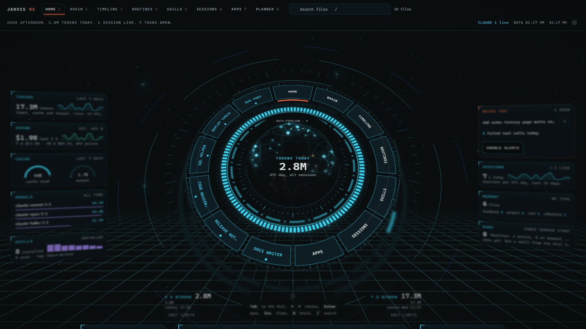
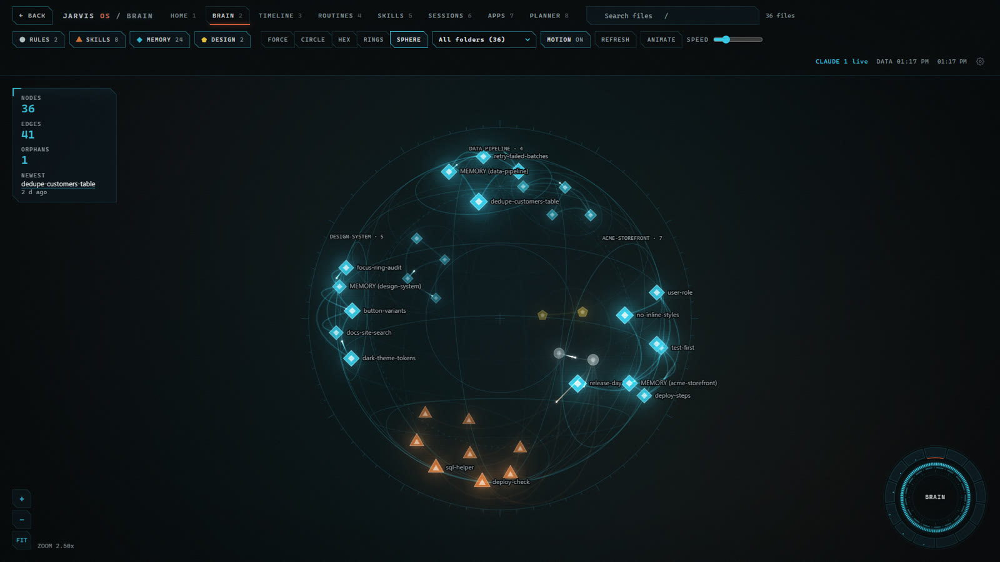
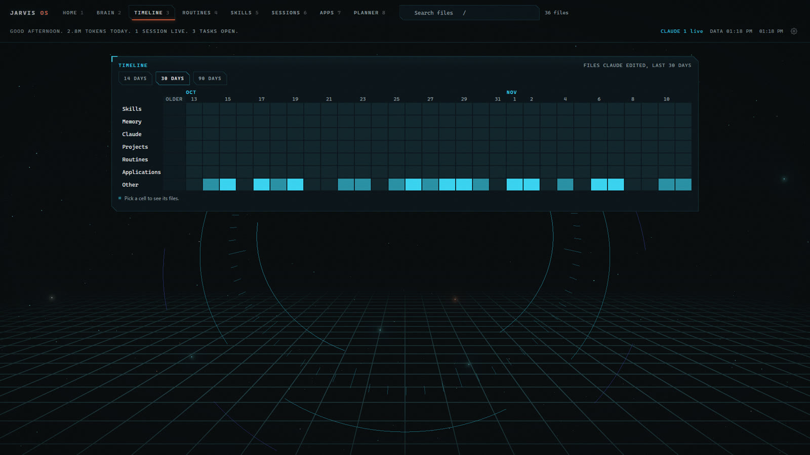
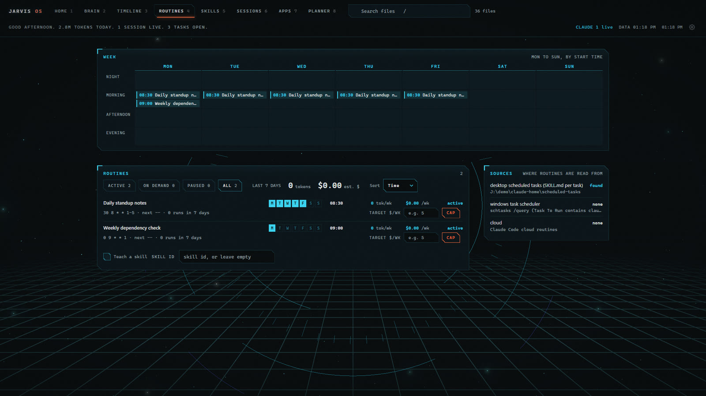
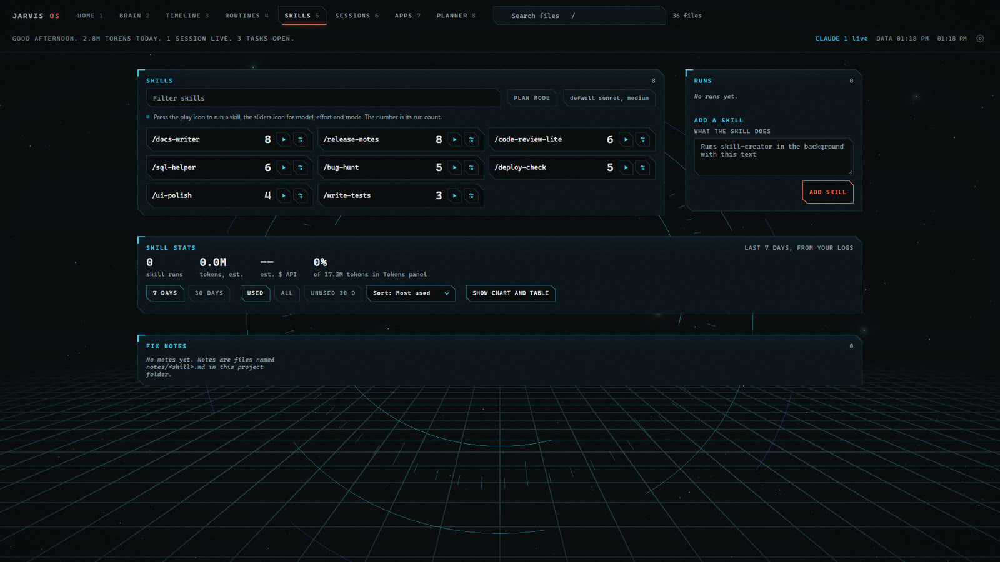
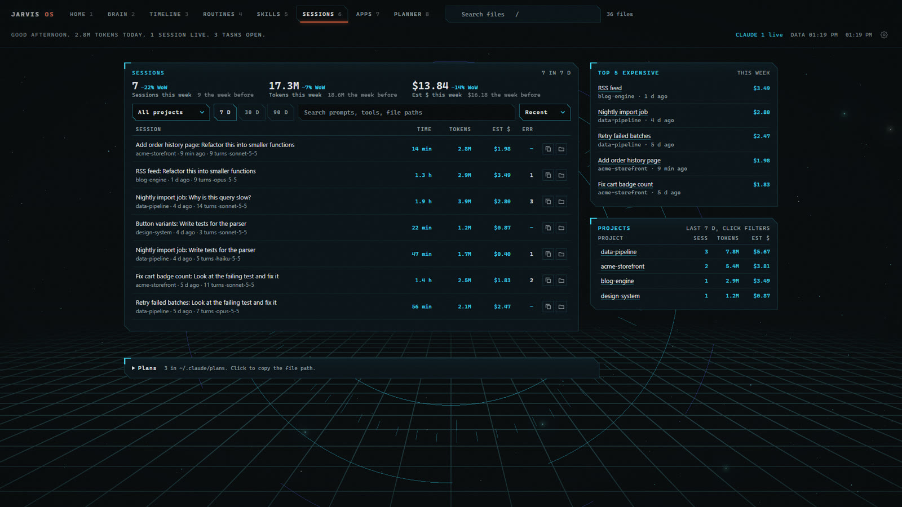
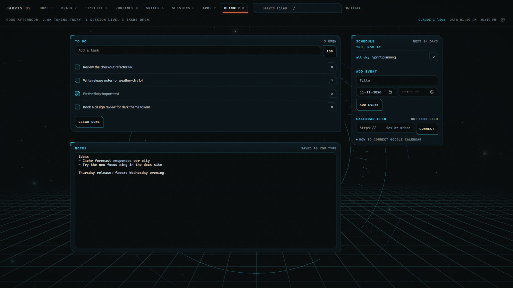

# Jarvis OS

A local dashboard for [Claude Code](https://claude.com/claude-code). It reads the files Claude Code already writes on your machine (session logs, skills, memory, plans, scheduled tasks) and shows them as one sci-fi HUD: token use and cost, a graph of your rules and memory, a timeline, routines, skills, sessions, local apps and a planner.

Everything runs on your computer. No account, no cloud, no npm install, no telemetry.


**[Watch the full 40 second tour with sound (MP4, 2.4 MB)](docs/images/reel.mp4)**

> The images and the video show demo mode. All names, projects and numbers in them are invented.

## Contents

- [Quick start](#quick-start)
- [Pages](#pages)
- [Display and accessibility](#display-and-accessibility)
- [Keyboard](#keyboard)
- [Configuration](#configuration)
- [Planner and Google Calendar](#planner-and-google-calendar)
- [Start with Windows](#start-with-windows)
- [Privacy and security](#privacy-and-security)
- [Set it up with an AI agent](#set-it-up-with-an-ai-agent)
- [Development](#development)
- [FAQ](#faq)

## Quick start

You need [Node.js](https://nodejs.org) 24 or newer. There are no packages to install.

### Easiest: let Claude Code set it up

Copy the address of this GitHub page, open [Claude Code](https://claude.com/claude-code) in any folder, and paste:

> Set up Jarvis OS for me: <paste the address here>

Claude downloads the app, asks you a few short questions (each has a default, so you can answer "use the defaults"), writes your config, starts the dashboard and gives you the link. It asks before it writes anything outside the app folder. Details are in [AGENTS.md](AGENTS.md).

> **For AI agents:** to install this, ask the user which folder to use (suggest `jarvis-os` in their home folder), `git clone` this repository there, then read `AGENTS.md` in the clone and follow "When the user asks you to set it up".

### By hand

```bash
git clone <this repo> jarvis-os
cd jarvis-os
node server.js
```

Open <http://127.0.0.1:4317>.

To try it without your own data, start demo mode. It writes fake sample data to `demo/` and reads only that:

```bash
node server.js --demo
```

Options:

| Option | What it does |
|---|---|
| `--demo` | Use invented sample data in `demo/`. Your own `~/.claude` folder is not read. |
| `--port=N` | Listen on port N. Default 4317. The `PORT` environment variable also works. |
| `CLAUDE_CONFIG_DIR` | Read Claude Code data from this folder in place of `~/.claude` (Claude Code uses the same variable). |
| `JARVIS_DATA` | Keep the app's own state (planner, runs, reports, cache) in this folder. Default: the app folder. |
| `CLAUDE_BIN` | Path to the `claude` command, if it is not on your PATH. Used only when you run a skill from the app. |

Platform: built and tested on Windows 11. The pages also work on macOS and Linux, but "Open folder" buttons and the Windows Task Scheduler source are Windows only.

## Pages

Press the number keys `1` to `8` to move between pages.

### 1. Home



A dial in the middle links to every page, with your memory graph at its core. The image shows the optional 3D HUD view (see [Display and accessibility](#display-and-accessibility)): the dial and panels tilt into depth layers, the graph becomes a slowly turning globe you can drag, and the panel you point at comes into focus.

A briefing line under the top bar sums up the day ("2.8M tokens today, 1 session live"). Click it to hear it read aloud with your browser's voice. Press `S` for a standby screen with a large clock; any key brings you back.

Panels around the dial show:

- **Tokens and spend**: last 5 hours, 7 days and 30 days, with sparklines. Dollar values are estimates at API prices; on a subscription plan you do not pay them.
- **Usage windows**: the 5 hour and 7 day windows, with limits you can edit ("Edit limits").
- **Cache**: how much input came from the prompt cache.
- **Models**: tokens per model.
- **Skills**: how many are installed and which you use most.
- **Needs you**: sessions that wait for your answer, and failed tool calls today. "Enable alerts" turns on browser notifications.
- **Sessions, memory and runs**: counts, with links to the full pages.

### 2. Brain



A graph of your rules (`CLAUDE.md`), skills, memory notes and design notes, with the links between them (`[[note]]` links and file mentions). Five layouts (force, circle, hex, rings, and sphere, which groups folders into patches on a globe), a folder filter, zoom, and a side panel that opens any file. Orphan notes (no links) are counted so you can clean them up.

### 3. Timeline



A heat map of the files Claude edited per day, grouped as skills, memory, Claude setup, projects, routines and apps. Pick a cell to see the files. 14, 30 or 90 days.

### 4. Routines



Scheduled work in one place: Claude desktop scheduled tasks (`~/.claude/scheduled-tasks/*/SKILL.md`) and Windows Task Scheduler jobs that run `claude`. A week grid shows when each one runs. Each routine shows its estimated token use and cost per week, and you can set a weekly dollar target. The Sources panel shows where each kind is read from.

### 5. Skills



Every installed skill with its run count. Press play to run a skill in the background with `claude -p` (pick model, effort and permission mode with the sliders icon). Runs and their reports show on the right. "Add a skill" asks Claude to write a new one from your description. Skill stats show runs, tokens and unused skills over 7 or 30 days.

### 6. Sessions



All Claude Code sessions with time, tokens, estimated cost and tool errors. Filter by project and date range, search prompts, tools and file paths, and compare this week to the week before. "Top 5 expensive" and a per-project table help you find where the tokens go. Each row can copy a resume command or open the project folder. Saved plans (`~/.claude/plans`) are listed at the bottom.

### 7. Apps

Three lists:

- **Tools**: local dev servers from each project's `.claude/launch.json`, with port state. Node entries can be started from here.
- **Micro apps**: single-file HTML apps in `apps/` (and any folder in `microAppDirs`).
- **Artifacts**: HTML files and other outputs in the folders you list in `artifactDirs`.

If you keep `~/.claude` in git, a setup sync chip shows uncommitted changes and unpushed commits there and in any repo in `gitRepos`.

### 8. Planner



- **To do**: add, tick, remove, clear done.
- **Notes**: one free text area, saved as you type.
- **Schedule**: your own events for the next 14 days, plus an optional read-only calendar feed (see [Planner and Google Calendar](#planner-and-google-calendar)).

Planner data stays in `data/planner.json` in the app folder.

### Search

Press `/` to search file names across your Claude folder, or `Ctrl+K` for the command palette (pages, actions, settings).

## Display and accessibility

Choose **Display** in the top bar (or search "display" in `Ctrl+K`), change what you want, then press **Apply changes**. Settings stay in your browser.

| Setting | Effect |
|---|---|
| Reduce motion | No boot sequence, drift, flights or animated numbers. Your system "reduce motion" setting is also respected. |
| High contrast | Brighter secondary text and borders. |
| Readable font | System sans serif font in place of the monospace UI font. |
| Background effects off | No particle background, grain or scan band. |
| System cursor | Normal mouse pointer in place of the targeting reticle. |
| 3D HUD view | Off by default. Home tilts into depth layers and the graph becomes a globe. Desktop only. |
| Depth of field | Inside the 3D HUD view row, on by default. Turn it off to keep every layer sharp (no focus blur). |
| Interface sounds | Off by default. Soft ticks on hover and click, and a sweep when you change page. |

For larger text, use browser zoom (`Ctrl` and `+`). All controls work with the keyboard and have a visible focus ring.

## Keyboard

| Key | Action |
|---|---|
| `1` to `8` | Go to a page |
| `/` | Search files |
| `Ctrl+K` | Command palette |
| `S` | Standby screen |
| `?` | Show all shortcuts |
| `B` | Switch between Home and Brain |
| `Tab`, arrow keys, `Enter`, `Esc` | Move around the Home dial, open, close |

## Configuration

The app works with no configuration. To change the defaults, copy `config.example.json` to `config.json` and edit it. `config.json` is ignored by git.

```json
{
  "name": "Jarvis OS",
  "limits": { "fiveHour": 200000000, "sevenDay": 1500000000 },
  "trimPrefixes": [],
  "gitRepos": [],
  "artifactDirs": [],
  "microAppDirs": [],
  "permissionMode": "plan"
}
```

| Key | Meaning |
|---|---|
| `name` | The name in the top bar. |
| `limits` | Token limits for the 5 hour and 7 day windows. You can also set them on Home with "Edit limits". Anthropic does not publish exact numbers, so set what matches your plan. |
| `trimPrefixes` | Folder name prefixes to cut from project names, for example `["C--Users-you-"]`. |
| `gitRepos` | Extra git repos for the setup sync chip, as full paths. |
| `artifactDirs` | Folders to list on the Apps page under Artifacts. |
| `microAppDirs` | Extra folders with single-file HTML apps. |
| `permissionMode` | Default permission mode for skill runs: `plan`, `default`, `acceptEdits` and so on. |
| `prices` | Optional. Override the token prices (USD per million tokens, by model family such as `opus`) used for dollar estimates. |

## Planner and Google Calendar

The planner can show a calendar next to your own events. It reads a standard iCal feed, so there is no Google sign-in and no API key.

1. In Google Calendar, open **Settings**, then your calendar under **Settings for my calendars**.
2. Go to **Integrate calendar** and copy **Secret address in iCal format**.
3. Paste it in **Calendar feed** on the Planner page and press **Connect**.

Notes:

- The secret address gives read access to that calendar. The app keeps it in `data/planner.json` on your machine and never sends it to the browser page; the page sees only the host name.
- Only `https://` and `webcal://` addresses are accepted. Any other iCal feed (Outlook, Apple, Fastmail) works the same way.
- The feed is read-only and refreshes every 10 minutes.
- Known limits: time zones (`TZID`) are not converted, and changed single instances of a repeating event (`RECURRENCE-ID`) are not applied.

## Start with Windows

To start the server when you log in (no admin rights needed):

```powershell
powershell -ExecutionPolicy Bypass -File scripts\install-autostart.ps1
```

This adds a hidden per-user task named `JARVIS` that runs `node server.js` on port 4317. To remove it:

```powershell
powershell -ExecutionPolicy Bypass -File scripts\uninstall-autostart.ps1
```

## Privacy and security

- The server listens on `127.0.0.1` only, and refuses requests with any other `Host` header.
- It reads your Claude Code folder and changes it only when you ask: running or adding a skill, or archiving one (moved to `skills/.archive`, not deleted). Otherwise it writes only its own files (`data/`, `cache/`, `reports/`, `runs.log`, and `config.json` when you edit limits).
- It makes no network requests, except the calendar feed if you add one. The spoken briefing uses your browser's speech voice; some browsers use an online voice for this, which sends the briefing text to the browser maker.
- Running a skill starts `claude -p` on your machine with the permission mode you pick. Start with `plan` if you are not sure.
- Demo mode reads only `demo/`.

## Set it up with an AI agent

[AGENTS.md](AGENTS.md) is a setup guide written for coding agents (Claude Code reads it through `CLAUDE.md`). Open the folder in Claude Code, Codex or another agent and ask:

> Set up Jarvis OS for me.

The agent checks Node, finds your Claude folder, asks you a few questions, writes `config.json`, starts the server and can add the Windows autostart task. You can also start from the GitHub link alone (see [Quick start](#quick-start)).

## Development

- Plain Node, no npm dependencies, no build step. The browser code is in `public/`, the server in `server.js` and `lib/`. The 3D effects use [three.js](https://threejs.org), included as files in `public/vendor/three` (MIT license).
- Tests: each `lib/*.test.js` file runs on its own, for example `node lib/planner.test.js`. Run all of them with:

  ```bash
  for f in lib/*.test.js; do node "$f" || echo "FAIL $f"; done
  ```

- `node scripts/make-demo.js` rebuilds the demo data. `node scripts/shot.js <url> <out.png>` takes a screenshot with headless Chrome (set `CHROME` to its path if it is not in the default place).

## FAQ

**Are the dollar amounts what I pay?** No. They are what the same tokens would cost on the API. On a Pro or Max plan you pay the plan price.

**Why are my limits not exact?** Anthropic does not publish token limits per plan. Set the numbers in "Edit limits" to match what you see in Claude.

**Is this made by Anthropic?** No. It is an independent project that reads Claude Code's local files. "Claude" is a trademark of Anthropic.

## License

[MIT](LICENSE).
